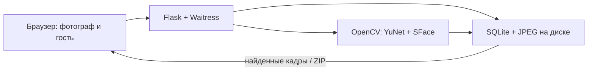

# FaceFlow

Локальная фотогалерея с поиском по селфи. Фотограф создаёт съёмку, загружает фотографии и открывает гостевую ссылку. Гость добавляет селфи с одним лицом, проверяет найденные кадры и скачивает отдельные фотографии или ZIP. Есть пауза публикации, смена ссылки и отметка «Не я». [Интерфейс](web/app.js), [API](docs/API.md).

[Видео демонстрации](demo/faceflow-demo.mp4) показывает текущий интерфейс на синтетических портретах. [Как повторить демонстрацию](docs/DEMO.md).

## Архитектура в одном экране



Фотографии индексируются один раз, селфи сравнивается с векторами выбранной съемки. Все это работает на одном компьютере. [Полная схема и точки входа](docs/ARCHITECTURE.md).

## Запуск на Windows

Нужен Python 3.12. Из корня проекта в PowerShell:

```powershell
python -m venv .venv
.venv/Scripts/python.exe -m pip install -r requirements.txt
.venv/Scripts/Activate.ps1
python scripts/download_models.py
python app.py --open
```

Приложение открывается на `http://127.0.0.1:8765`. Полная ссылка фотографа содержит секретный ключ: не публикуйте её и вывод терминала. Сервер слушает только этот компьютер; гостевая ссылка сама по себе не делает галерею доступной через интернет. [Запуск и ключи](app.py).

Если PowerShell запрещает активацию, выполняйте команды через `.venv/Scripts/python.exe`: активация нужна только для сокращения команды `python`.

## Демонстрация без личных фотографий

После установки зависимостей и моделей:

```powershell
$env:FACEFLOW_DATA = './work/demo-data'
python scripts/seed_demo.py
python app.py --port 8766 --open
```

Скрипт создаёт отдельную съёмку с четырьмя файлами: три изображения на основе двух синтетических портретов и один кадр без лица. Исходные портреты: [person-a.png](demo/synthetic/person-a.png) и [person-b.png](demo/synthetic/person-b.png). Секретные URL сохраняются только в локальном `work/demo-session.json`, который не должен попадать в Git. Подробности: [seed_demo.py](scripts/seed_demo.py), [демонстрация](docs/DEMO.md).

`FACEFLOW_DATA` задаётся через окружение процесса; `.env` автоматически не читается. После остановки демонстрации командой Ctrl+C верните обычный каталог данных:

```powershell
Remove-Item Env:FACEFLOW_DATA
```

## Что хранится и как работает поиск

По умолчанию данные находятся в `data/`: ключи доступа, SQLite, нормализованные JPEG, превью и векторы лиц. Селфи обрабатывается в памяти и не записывается приложением в каталог данных. Удаление съёмки удаляет её копии фотографий и индекс; исходные файлы пользователя не изменяются. Это не гарантия удаления следов из резервных копий или с физического накопителя. [Хранение и безопасность](docs/ARCHITECTURE.md).

YuNet находит лица, SFace строит векторы; сравнение выполняется локально на CPU. В этом пути нет LLM, облачного inference или платного API на каждый запрос. Время обработки, память и диск зависят от снимков и компьютера. [recognition.py](recognition.py), [зависимости](requirements.txt).

Веса ONNX скачиваются из OpenCV Zoo с закреплённой ревизией и SHA-256, в Git они не входят. YuNet использует MIT, SFace - Apache 2.0; ссылки на веса закреплены в [manifest.json](models/manifest.json), тексты лицензий находятся в [YuNet-LICENSE.txt](models/YuNet-LICENSE.txt) и [SFace-LICENSE.txt](models/SFace-LICENSE.txt). Это лицензии моделей, выбор лицензии самого проекта здесь не сделан.

Порог сходства `0.60` унаследован. Этот публичный экспорт не содержит независимой оценки точности на реальных людях; возможны пропуски и чужие кадры. Результаты нужно проверять глазами. [Порог](evaluation/threshold.json), [поиск](app.py), [текущие ограничения и план](PLAN.md).

## Проверка и развитие

```powershell
python -m unittest discover -s tests -v
```

Тесты используют настоящие YuNet/SFace и два синтетических исходных портрета. Позитивный пример с изменением яркости того же исходника проверяет работу цепочки, но не независимую точность распознавания. [Тесты](tests/test_flow.py).

Для изменений: [правила проекта](AGENTS.md), [архитектура и точки входа](docs/ARCHITECTURE.md), [контракт API](docs/API.md), [план](PLAN.md).
