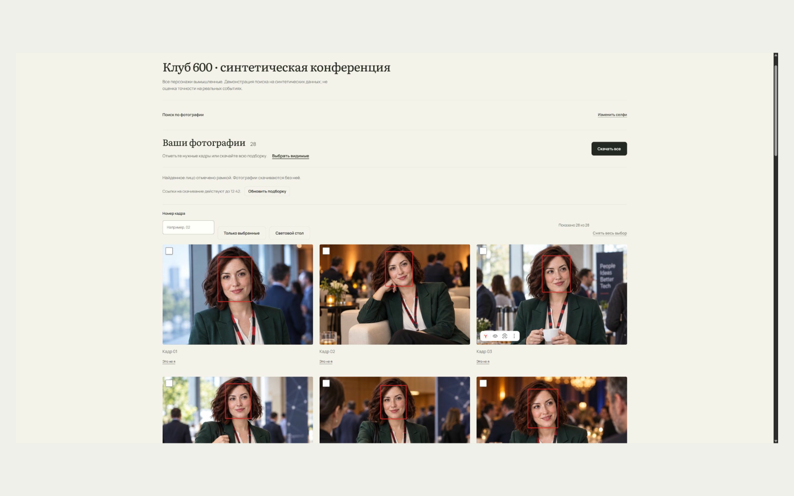
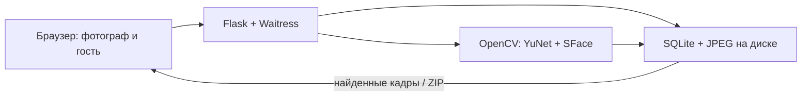

# FaceFlow

Локальная фотогалерея: участник находит свои кадры по селфи и скачивает подборку.

<p><a href="#статус-и-ограничения"></a> <a href="https://github.com/malyarq/faceflow/actions/workflows/ci.yml"></a> <a href="requirements.txt"></a> <a href="docs/assets/readme/current-flow.mp4"></a></p>

**[Скриншоты](#как-выглядит) · [Возможности](#что-работает) · [Запуск](#запуск) · [Архитектура](#архитектура) · [Ограничения](#статус-и-ограничения) · [Разработка](#разработка)**

## Как выглядит

Интерфейс использует фотоальбом с обложками съёмок, локальными шрифтами и сдержанными переходами. [Дизайн и выбор инструментов](docs/DESIGN.md).

<a href="docs/assets/readme/overview.svg"></a>

Световой стол, галерея и управление выбранными фотографиями на компьютере и телефоне. На снимках отдельная синтетическая съёмка; поиск и скачивание проходят через локальный backend. [Источник снимков](docs/assets/readme/prototype-transfer.json).

В предыдущем ролике используются фотографии Wikimania 2019. [Авторы и лицензии](demo/product/credits.md).

**[Актуальное демо MP4](docs/assets/readme/current-flow.mp4)** · 00:20 · 26 октября 2026 · [Источник записи](docs/assets/readme/current-flow.json)

[Предыдущее демо, 00:50](demo/product/faceflow-demo.mp4) · [Материалы демо](docs/DEMO.md)

<details>
<summary>Ещё два экрана</summary>

**Галерея и управление выбором.**

<a href="docs/assets/readme/screen-2.svg"></a>

**Подборка на телефоне.**

<a href="docs/assets/readme/screen-3.svg"></a>

</details>

## Что работает

- **Основное:** создать съёмку, загрузить и проиндексировать фотографии, опубликовать или сменить гостевую ссылку, приостановить доступ. [API](docs/API.md).
- **Дополнительно:** найти свои кадры по селфи, открыть фотографию, скачать JPEG или ZIP, отметить чужой результат; повторить обработку ошибок и удалить съёмку. [Клиент](web/app.js), [API](docs/API.md).
- **Данные:** локальное распознавание на CPU с YuNet/SFace, индекс в SQLite и JPEG на диске. [Архитектура](docs/ARCHITECTURE.md).

## Запуск

### Требования

Нужен Python 3.12. Из корня проекта в PowerShell:

### Быстрый старт

```powershell
git clone https://github.com/malyarq/faceflow.git
cd faceflow
python -m venv .venv
.venv/Scripts/python.exe -m pip install -r requirements.txt
.venv/Scripts/python.exe scripts/download_models.py
.venv/Scripts/python.exe app.py --open
```

### Данные и доступ

Приложение открывается на `http://127.0.0.1:8765`. Полная ссылка фотографа содержит секретный ключ: не публикуйте её и вывод терминала. Сервер слушает только этот компьютер; гостевая ссылка сама по себе не делает галерею доступной через интернет. [Запуск и ключи](app.py).

Для проверки без личных фотографий есть отдельный синтетический альбом. [Запуск демо](docs/DEMO.md#запуск), [предыдущий ролик и материалы](demo/product/README.md).

## Архитектура



Путь данных: фотографии → лица YuNet → векторы SFace → индекс съёмки в SQLite. Селфи сравнивается с этим индексом; найденные JPEG возвращаются по подписанным ссылкам, выбранные кадры собираются в ZIP. [Полная схема и точки входа](docs/ARCHITECTURE.md).

По умолчанию данные находятся в `data/`: ключи доступа, база, JPEG, превью и векторы лиц. Селфи обрабатывается в памяти и не записывается приложением в каталог данных. Удаление съёмки удаляет её копии фотографий и индекс, сохраняя исходные файлы пользователя; это не гарантия стирания следов с накопителя или резервных копий. [Хранение и безопасность](docs/ARCHITECTURE.md).

## Статус и ограничения

| Параметр | Состояние |
| --- | --- |
| Стадия | В разработке. [План](PLAN.md). |
| Версия | Не задана; отдельного релиза нет. [План](PLAN.md). |
| Лицензия | Не выбрана для собственного кода. [Права на материалы](THIRD_PARTY.md). |

### Ограничения

YuNet и SFace - нейросетевые модели, работающие локально на CPU. Сопоставление векторов использует унаследованный порог `0.60`, проверки размера и размытия лица - эвристики. LLM и облачного inference в поиске нет. Веса закреплены по ревизии и SHA-256, скачиваются отдельно и не входят в Git. [Распознавание](recognition.py), [порог](evaluation/threshold.json), [manifest](models/manifest.json).

Независимая точность на реальных людях не измерена. Автотесты на синтетических исходниках проверяют работу приложения, а демо на реальных фотографиях показывает интерфейс. Ни то ни другое не заменяет независимую оценку распознавания. Возможны пропуски и чужие кадры; результаты нужно проверять глазами. Не проверены большие съёмки, Linux, все браузеры и удобство для реальных пользователей. Время обработки, память и диск зависят от снимков и компьютера. [Проверки и их границы](docs/VERIFICATION.md), [план](PLAN.md).

Доступ основан на секретных ссылках, отдельного rate limiting нет, файлы на диске не шифруются приложением. Безопасность интернет-хостинга не проверена; приложение локально и в интернет не развёрнуто. [Доступ и ограничения](docs/ARCHITECTURE.md).

## Разработка

[Документация](docs/ARCHITECTURE.md) · [Браузерные проверки](docs/BROWSER_CHECKS.md) · [План](PLAN.md) · [Правила](AGENTS.md) · [CI](https://github.com/malyarq/faceflow/actions/workflows/ci.yml)

<details>
<summary>Проверки и работа над проектом</summary>

```powershell
python -m unittest discover -s tests -v
node --test tests/test_upload.cjs tests/test_settings.cjs tests/test_readiness.cjs tests/test_search.cjs tests/test_expiry.cjs
```

[CI](https://github.com/malyarq/faceflow/actions/workflows/ci.yml) проверяет синтаксис Python/JavaScript и запускает [интеграционные тесты](tests/test_flow.py) на Windows с Python 3.12 и настоящими YuNet/SFace. Только синтетические исходники и временное хранилище. Отчёт покрытия строк и ветвей `app.py` и `recognition.py` доступен в логах и сводке каждого прогона; это покрытие кода, не точность распознавания. CI запускается на push в `main`, pull request и вручную. Для скачивания HTML и JSON при ручном запуске включите `upload_coverage`: архив `coverage-report` хранится семь дней. [Workflow](.github/workflows/ci.yml), [настройки покрытия](.coveragerc), [проверенный прогон и ограничения](docs/VERIFICATION.md).

Чтобы измерить покрытие локально:

```powershell
python -m pip install -r requirements-dev.txt
python -m coverage run -m unittest discover -s tests -v
python -m coverage report -m
python -m coverage html -d work/coverage/html
```

Для работы и координации изменений: [AGENTS.md](AGENTS.md), [план](PLAN.md), [точки входа](docs/ARCHITECTURE.md), [контракт API](docs/API.md). Для воспроизведения скриншотов, озвучки и монтажа: [инструкции демо](docs/DEMO.md).

Лицензия собственного кода не выбрана. У YuNet - MIT, у SFace - Apache 2.0; это не назначает лицензию проекту. [Права и сторонние материалы](THIRD_PARTY.md), [YuNet-LICENSE.txt](models/YuNet-LICENSE.txt), [SFace-LICENSE.txt](models/SFace-LICENSE.txt).

</details>
