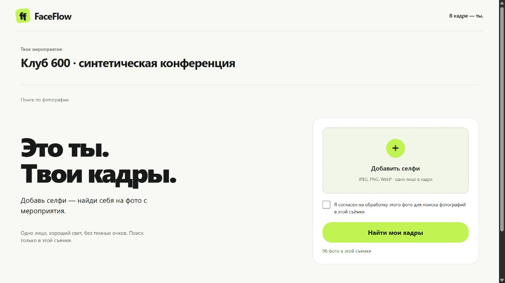
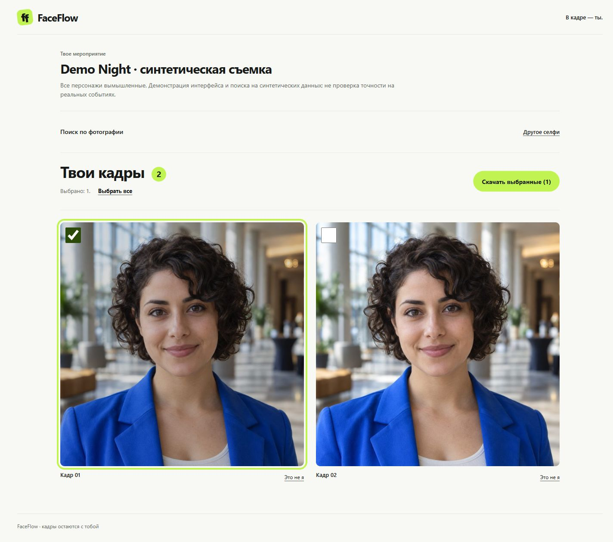
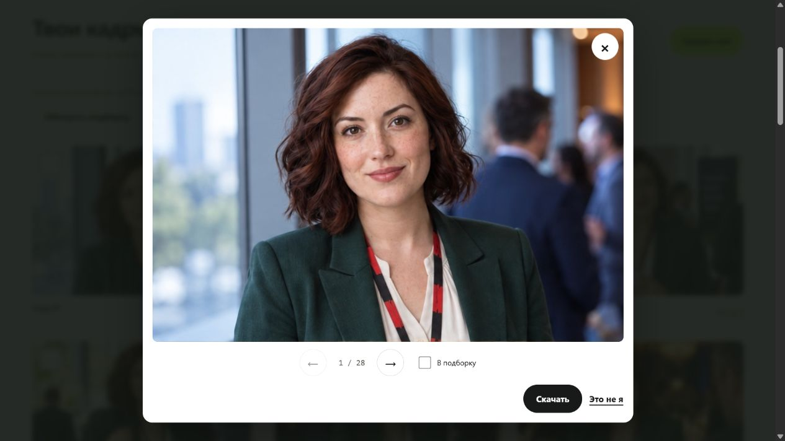
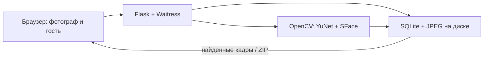

# FaceFlow

[](#запуск-на-windows)
[](requirements.txt)
[](models/manifest.json)
[](PLAN.md)

**Найди свои фотографии с мероприятия по одному селфи.**

Фотограф загружает съёмку и выдаёт гостевую ссылку. Участник добавляет селфи, проверяет найденные кадры и скачивает свою подборку. Поиск работает на компьютере фотографа. [Интерфейс](web/app.js), [путь данных](docs/ARCHITECTURE.md).

**[Скачать демо MP4](https://github.com/malyarq/faceflow/raw/refs/heads/main/demo/faceflow-demo.mp4)** · **[Запустить](#запуск-на-windows)** · **[План](PLAN.md)** · **[Для агента](AGENTS.md)** · **[Документация](docs/ARCHITECTURE.md)**

## Как это выглядит

Скриншоты текущего интерфейса на синтетических данных. Все персонажи вымышленные; происхождение исходников описано в [демо](demo/synthetic/PROVENANCE.md).

**1. Открыть съёмку и добавить селфи**



**2. Проверить результаты и выбрать кадры для ZIP**



**3. Рассмотреть фотографию перед скачиванием**



[Скачать видео со звуком](https://github.com/malyarq/faceflow/raw/refs/heads/main/demo/faceflow-demo.mp4) · [Повторить демо и пересобрать ролик](docs/DEMO.md)

## Что работает

- Фотограф: создание съёмки, загрузка и индексация фотографий, публикация и пауза, смена гостевой ссылки. [API](docs/API.md).
- Гость: поиск по селфи с одним лицом, просмотр, скачивание JPEG или выбранных кадров в ZIP, отметка «Не я». [Клиент](web/app.js).
- Локальное хранение и распознавание на CPU с YuNet/SFace. [Архитектура](docs/ARCHITECTURE.md).

**Ограничения:** публичный экспорт не содержит независимой оценки точности на реальных людях. Возможны пропуски и чужие кадры; результаты нужно проверять глазами. Сервер по умолчанию доступен только на этом компьютере. [Проверки](docs/VERIFICATION.md), [план](PLAN.md).

## Архитектура в одном экране



Путь данных: фотографии → лица YuNet → векторы SFace → индекс съёмки в SQLite. Селфи сравнивается с этим индексом; найденные JPEG возвращаются по подписанным ссылкам, выбранные кадры собираются в ZIP. [Полная схема и точки входа](docs/ARCHITECTURE.md).

## Запуск на Windows

Нужен Python 3.12. Из корня проекта в PowerShell:

```powershell
python -m venv .venv
.venv/Scripts/python.exe -m pip install -r requirements.txt
.venv/Scripts/Activate.ps1
python scripts/download_models.py
python app.py --open
```

Приложение открывается на `http://127.0.0.1:8765`. Полная ссылка фотографа содержит секретный ключ: не публикуйте её и вывод терминала. Сервер слушает только этот компьютер; гостевая ссылка сама по себе не делает галерею доступной через интернет. [Запуск и ключи](app.py).

Если PowerShell запрещает активацию, выполняйте команды через `.venv/Scripts/python.exe`: активация нужна только для сокращения команды `python`.

## Демонстрация без личных фотографий

После установки зависимостей и моделей:

```powershell
$env:FACEFLOW_DATA = './work/demo-data'
python scripts/seed_demo.py
python app.py --port 8766 --open
```

Скрипт создаёт отдельную съёмку с четырьмя файлами: три изображения на основе двух синтетических портретов и один кадр без лица. Исходные портреты: [person-a.png](demo/synthetic/person-a.png) и [person-b.png](demo/synthetic/person-b.png). Секретные URL сохраняются только в локальном `work/demo-session.json`, который не должен попадать в Git. Подробности: [seed_demo.py](scripts/seed_demo.py), [демонстрация](docs/DEMO.md).

`FACEFLOW_DATA` задаётся через окружение процесса; `.env` автоматически не читается. После остановки демонстрации командой Ctrl+C верните обычный каталог данных:

```powershell
Remove-Item Env:FACEFLOW_DATA
```

## Что хранится и как работает поиск

По умолчанию данные находятся в `data/`: ключи доступа, SQLite, нормализованные JPEG, превью и векторы лиц. Селфи обрабатывается в памяти и не записывается приложением в каталог данных. Удаление съёмки удаляет её копии фотографий и индекс; исходные файлы пользователя не изменяются. Это не гарантия удаления следов из резервных копий или с физического накопителя. [Хранение и безопасность](docs/ARCHITECTURE.md).

YuNet находит лица, SFace строит векторы; сравнение выполняется локально на CPU. В этом пути нет LLM, облачного inference или платного API на каждый запрос. Время обработки, память и диск зависят от снимков и компьютера. [recognition.py](recognition.py), [зависимости](requirements.txt).

Веса ONNX скачиваются из OpenCV Zoo с закреплённой ревизией и SHA-256, в Git они не входят. YuNet использует MIT, SFace - Apache 2.0; ссылки на веса закреплены в [manifest.json](models/manifest.json), тексты лицензий находятся в [YuNet-LICENSE.txt](models/YuNet-LICENSE.txt) и [SFace-LICENSE.txt](models/SFace-LICENSE.txt). Это лицензии моделей, выбор лицензии самого проекта здесь не сделан.

Порог сходства `0.60` унаследован. Этот публичный экспорт не содержит независимой оценки точности на реальных людях; возможны пропуски и чужие кадры. Результаты нужно проверять глазами. [Порог](evaluation/threshold.json), [поиск](app.py), [текущие ограничения и план](PLAN.md).

## Проверка и развитие

```powershell
python -m unittest discover -s tests -v
```

Тесты используют настоящие YuNet/SFace и два синтетических исходных портрета. Позитивный пример с изменением яркости того же исходника проверяет работу цепочки, но не независимую точность распознавания. [Тесты](tests/test_flow.py).

Для изменений: [правила проекта](AGENTS.md), [архитектура и точки входа](docs/ARCHITECTURE.md), [контракт API](docs/API.md), [план](PLAN.md).
