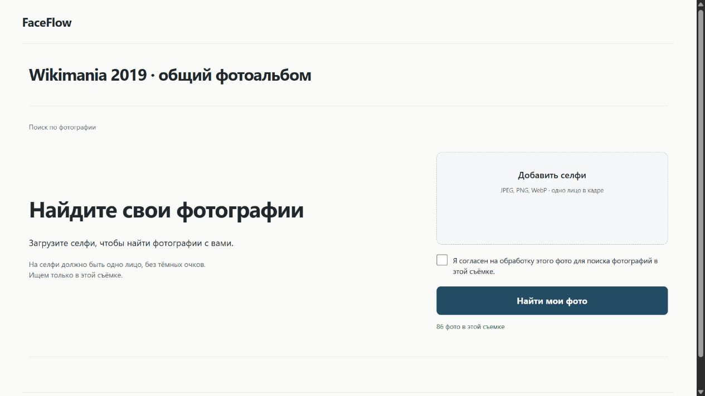
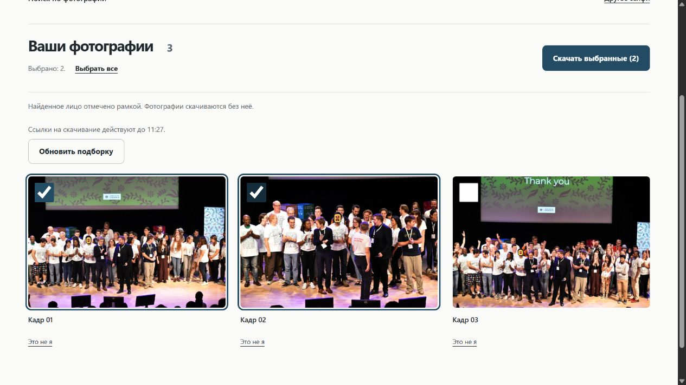
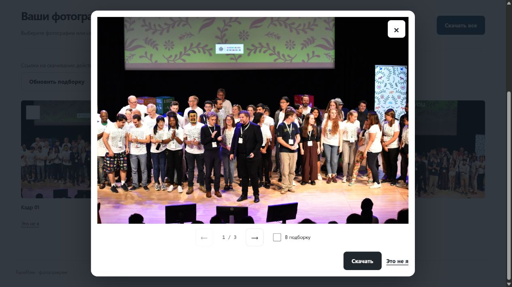
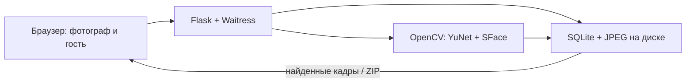

# FaceFlow

Локальная фотогалерея: участник находит свои кадры по селфи и скачивает подборку.

<p><a href="PLAN.md"></a> <a href="https://github.com/malyarq/faceflow/actions/workflows/ci.yml"></a> <a href="requirements.txt"></a> <a href="https://github.com/malyarq/faceflow/raw/refs/heads/main/demo/product/faceflow-demo.mp4"></a> <a href="https://github.com/malyarq/faceflow/actions/workflows/ci.yml"></a></p>

**[Демо](https://github.com/malyarq/faceflow/raw/refs/heads/main/demo/product/faceflow-demo.mp4) · [Запуск](#запуск) · [Архитектура](#архитектура) · [План](PLAN.md) · [Для агента](AGENTS.md)**

## Как выглядит

Актуальный интерфейс на реальной съёмке Wikimania 2019: светлые поверхности, синие кнопки и прямые подписи действий. Демо в навигации - 50 секунд, русские субтитры, без звука. [Авторы и лицензии снимков](demo/product/credits.md).

**1. Открыть съёмку и добавить селфи**



**2. Проверить результаты и выбрать кадры для ZIP**



**3. Найти себя в кадре и рассмотреть фотографию**



Найденное лицо отмечено рамкой в подборке и при просмотре. JPEG и ZIP скачиваются без неё. [Как устроен поиск](docs/API.md#поиск).

## Что работает

- Фотограф: создание съёмки, загрузка и индексация фотографий, публикация и пауза, смена гостевой ссылки, повтор обработки ошибок и удаление съёмки. [API](docs/API.md).
- Гость: поиск по селфи с одним лицом, просмотр, скачивание JPEG или выбранных кадров в ZIP, отметка «Не я». [Клиент](web/app.js).
- Локальное распознавание на CPU с YuNet/SFace и хранение в SQLite и JPEG. [Архитектура](docs/ARCHITECTURE.md).

## Запуск

Нужен Python 3.12. Из корня проекта в PowerShell:

```powershell
python -m venv .venv
.venv/Scripts/python.exe -m pip install -r requirements.txt
.venv/Scripts/Activate.ps1
python scripts/download_models.py
python app.py --open
```

Приложение открывается на `http://127.0.0.1:8765`. Полная ссылка фотографа содержит секретный ключ: не публикуйте её и вывод терминала. Сервер слушает только этот компьютер; гостевая ссылка сама по себе не делает галерею доступной через интернет. [Запуск и ключи](app.py).

Если PowerShell запрещает активацию, выполняйте команды через `.venv/Scripts/python.exe`. Активация нужна только для сокращения команды `python`.

Для демонстрации без личных фотографий после установки моделей:

```powershell
$env:FACEFLOW_DATA = './work/demo-data'
python scripts/seed_demo.py
python app.py --port 8766 --open
```

Скрипт добавляет отдельную съёмку с 96 синтетическими фотографиями по манифесту. Секретные URL сохраняются в исключённом из Git `work/demo-session.json`; сидер всегда использует `work/demo-data`. После остановки демо через Ctrl+C выполните `Remove-Item Env:FACEFLOW_DATA`. [Подробности, результаты проверки и пересборка ролика](docs/DEMO.md), [скрипт](scripts/seed_demo.py).

## Архитектура



Путь данных: фотографии → лица YuNet → векторы SFace → индекс съёмки в SQLite. Селфи сравнивается с этим индексом; найденные JPEG возвращаются по подписанным ссылкам, выбранные кадры собираются в ZIP. [Полная схема и точки входа](docs/ARCHITECTURE.md).

По умолчанию данные находятся в `data/`: ключи доступа, база, JPEG, превью и векторы лиц. Селфи обрабатывается в памяти и не записывается приложением в каталог данных. Удаление съёмки удаляет её копии фотографий и индекс, сохраняя исходные файлы пользователя; это не гарантия стирания следов с накопителя или резервных копий. [Хранение и безопасность](docs/ARCHITECTURE.md).

## Статус и ограничения

Стадия - локальный MVP в разработке. Версия продукта в коде не задана; отдельного релиза нет. Текущее состояние и дальнейшие задачи: [PLAN.md](PLAN.md).

YuNet и SFace - нейросетевые модели, работающие локально на CPU. Сопоставление векторов использует унаследованный порог `0.60`, проверки размера и размытия лица - эвристики. LLM и облачного inference в поиске нет. Веса закреплены по ревизии и SHA-256, скачиваются отдельно и не входят в Git. [Распознавание](recognition.py), [порог](evaluation/threshold.json), [manifest](models/manifest.json).

Независимая точность на реальных людях не измерена. Два синтетических портрета и изменение яркости одного исходника проверяют цепочку, но не качество на мероприятиях. Возможны пропуски и чужие кадры; результаты нужно проверять глазами. Не проверены большие съёмки, Linux, все браузеры и удобство для реальных пользователей. Время обработки, память и диск зависят от снимков и компьютера. [Проверки и их границы](docs/VERIFICATION.md), [план](PLAN.md).

Доступ основан на секретных ссылках, отдельного rate limiting нет, файлы на диске не шифруются приложением. Безопасность интернет-хостинга не проверена; приложение локально и в интернет не развёрнуто. [Доступ и ограничения](docs/ARCHITECTURE.md).

## Разработка

```powershell
python -m unittest discover -s tests -v
node --test tests/test_upload.cjs tests/test_settings.cjs tests/test_readiness.cjs tests/test_search.cjs tests/test_expiry.cjs
```

[CI](https://github.com/malyarq/faceflow/actions/workflows/ci.yml) проверяет синтаксис Python/JavaScript и запускает [интеграционные тесты](tests/test_flow.py) на Windows с Python 3.12 и настоящими YuNet/SFace. Только синтетические исходники и временное хранилище. В артефакте `coverage-report` каждого прогона доступны HTML и JSON покрытия строк и ветвей `app.py` и `recognition.py`; это покрытие кода, не точность распознавания. [Workflow](.github/workflows/ci.yml), [настройки покрытия](.coveragerc), [проверенный прогон и ограничения](docs/VERIFICATION.md).

Чтобы измерить покрытие локально:

```powershell
python -m pip install -r requirements-dev.txt
python -m coverage run -m unittest discover -s tests -v
python -m coverage report -m
python -m coverage html -d work/coverage/html
```

Для работы и координации изменений: [AGENTS.md](AGENTS.md), [план](PLAN.md), [точки входа](docs/ARCHITECTURE.md), [контракт API](docs/API.md). Для воспроизведения скриншотов, озвучки и монтажа: [инструкции демо](docs/DEMO.md).

Лицензия собственного кода не выбрана. У YuNet - MIT, у SFace - Apache 2.0; это не назначает лицензию проекту. [Права и сторонние материалы](THIRD_PARTY.md), [YuNet-LICENSE.txt](models/YuNet-LICENSE.txt), [SFace-LICENSE.txt](models/SFace-LICENSE.txt).
