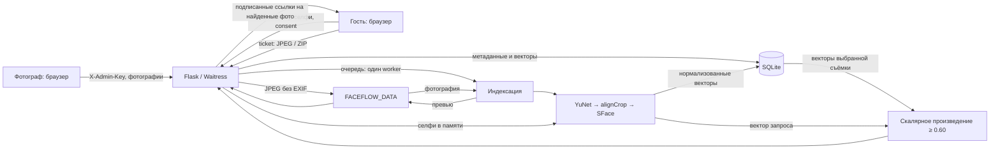

# Архитектура

FaceFlow - один локальный Python-процесс с Flask/Waitress, статическим браузерным клиентом, SQLite и файловым хранилищем. Сети YuNet/SFace создаются отдельно для каждого потока, inference выполняется через OpenCV. [app.py](../app.py), [recognition.py: engine](../recognition.py), [web/app.js](../web/app.js).

Диаграмма соответствует [upload, index_photo, search, media, download](../app.py) и [analyze](../recognition.py). Внешнего AI-провайдера в этой цепочке нет; сеть используется скриптом загрузки моделей, не inference. [download_models.py](../scripts/download_models.py).

## Путь данных

1. `upload` проверяет административный ключ, формат и ограничения. Pillow применяет EXIF orientation и переводит изображение в RGB; копия сохраняется JPEG с quality 95, без переноса EXIF. SHA-256 исходных байтов используется для дедупликации внутри съёмки, имя файла хранится как метаданные. Оригинал пользователя не меняется. [app.py: decode, upload](../app.py).
2. В SQLite появляется `pending`. Один worker вызывает `index_photo`; дорогой inference выполняется вне общей блокировки. Проверка `generation` перед записью защищает от результата устаревшей переиндексации. Создаются превью до 720×720 и записи `faces`, статус становится `ready` либо `error`. [app.py: pool, index_photo, requeue](../app.py).
3. `analyze` переводит изображение в BGR, детектирует лица YuNet, удаляет пересекающиеся кандидаты, выравнивает лицо и строит нормализованный float32-вектор SFace. Флаги `small_face` и `blurred_face` являются эвристиками. `detailed` добавляет перекрывающиеся плитки для изображений с большой стороной более 1800 пикселей. [recognition.py: analyze, overlap](../recognition.py).
4. `search` принимает согласие `consent=yes` и селфи. Нужно ровно одно найденное лицо без `small_face`. Селфи и multipart-поток находятся в памяти: приложение не записывает их в свою файловую систему. После проверки готовности съёмки сравниваются только её `ready`-векторы. Для каждого фото выбирается лучшее совпадение от порога; числовой score удаляется из ответа. [app.py: MemoryUploadRequest, search](../app.py).
5. Клиент получает разрешённые ID и подписанные ссылки. `media` и `download` заново проверяют ticket и существование файлов. ZIP собирается в памяти с лимитом 256 МиБ суммарных JPEG; это не лимит общего потребления RAM процесса. [app.py: access_ticket, media, download](../app.py).

Порог `0.60` унаследован и задаётся [evaluation/threshold.json](../evaluation/threshold.json). Независимая оценка точности в текущей реализации отсутствует; [тесты](../tests/test_flow.py) проверяют цепочку на синтетических исходниках.

## Хранилище и схема

`FACEFLOW_DATA` читается из окружения при импорте `app.py`, по умолчанию используется `<корень>/data`. Относительный путь разрешается от текущего рабочего каталога. `.env` автоматически не загружается. [app.py: DATA](../app.py), [.env.example](../.env.example).

| Объект | Назначение |
| --- | --- |
| `config.json` | Секрет административного доступа и ключ подписи; создаются при первом импорте |
| `faceflow.sqlite` и файлы WAL/SHM | Метаданные съёмок, фото, векторы, счётчики, обратная связь |
| `<event>/<photo>.jpg` | Нормализованный JPEG |
| `<event>/<photo>-thumb.jpg` | Превью |
| `.trash/<operation>/` | Временный журнал удаления и переименованные файлы |
| `.instance.lock` | Блокировка одного штатного процесса на каталог данных |

Источник: [app.py: CONFIG_FILE, db, index_photo, remove_storage, acquire_data_lock](../app.py).

| Таблица | Ключевые поля и связи |
| --- | --- |
| `events` | `id` PK, `title`, `guest`, `created`, `description`, `status`, `detailed`, `link_version` |
| `photos` | `id` PK, `event` FK, `name`, `hash`, `size`, `status`, `error`, `count`, `width`, `height`, `warnings`, `generation`, `duration_ms`; UNIQUE(event, hash) |
| `faces` | `photo` FK, `vector` BLOB: нормализованный float32-вектор |
| `metrics` | PK(event, name), `count`; names: views, searches, downloads |
| `feedback` | `event` FK, `photo` FK, `grant` (SHA-256 ticket), `kind`, `created`; UNIQUE(event, photo, grant, kind) |

SQLite включает WAL, foreign keys и secure_delete. FK удаляются каскадно; добавочные миграции выполняются при импорте, `user_version=2` используется для обновления `size`. Это не отдельный migration framework. [app.py: db и блок создания схемы](../app.py).

## Жизненный цикл и конкуренция

Новая съёмка - `draft`; публикация требует хотя бы одного `ready` и нулевой очереди `pending`. `paused` закрывает поиск и гостевые media tickets. Изменение `detailed` заново ставит все фотографии в очередь, retry - только ошибки. Статусы фото: `pending`, `ready`, `error`. [app.py: create_event, update_event, requeue, search, access_ticket](../app.py).

Удаление сначала перемещает файлы в `.trash`, затем фиксирует SQLite, затем очищает staging. При ошибке транзакции файлы возвращаются. `recover_deletions` при штатном старте определяет по базе, восстанавливать файлы или завершать удаление. Очередь `pending` возобновляется. RLock координирует запись, выдачу и удаление; inference не удерживает её. [app.py: remove_storage, restore_staged, recover_deletions, index_photo, __main__](../app.py).

Waitress запускается на `127.0.0.1`, по умолчанию порт 8765, четыре HTTP-потока; очередь индексации имеет один worker, OpenCV ограничен двумя внутренними потоками. Блокировка каталога выполняется в CLI-точке запуска, поэтому импорт Flask app сторонним сервером сам по себе не обеспечивает эту защиту. [app.py: pool, acquire_data_lock, __main__](../app.py).

## Доступ и ограничения безопасности

- Административная ссылка содержит `#admin=...`; клиент переносит ключ в `sessionStorage` и убирает fragment из адреса. Гостевая ссылка имеет `/e/<id>#g=...`; ключ передаётся заголовком. Это секреты доступа, не аккаунты с отдельными ролями. [web/app.js: начало файла, api](../web/app.js), [app.py: admin, event](../app.py).
- Ticket подписан `itsdangerous`, связан со съёмкой, конкретными photo ID, `link_version` и признаком административного доступа. Срок - 1200 секунд. Смена ссылки меняет guest key и version, аннулируя прежние tickets, включая административные. Подписанный payload не зашифрован. [app.py: make_ticket, rotate_link, access_ticket](../app.py).
- Ответы имеют `no-store`, `no-referrer`, CSP и `nosniff`. Приложение не шифрует фото, векторы и ключи на диске; отдельного rate limiting в коде нет. Удаление не является доказательством физического стирания с SSD, памяти или резервных копий. [app.py: headers, db, remove_storage](../app.py).
- Гостевой GET допускает просмотр заголовка и счётчиков своей съёмки даже до публикации; фотографии выдаются только по ticket, поиск требует `published`. Метрика views использует cookie на сутки, а не точный подсчёт уникальных людей. [app.py: get_event, search, media](../app.py).

Публичный сетевой сервис, правовой режим реальных данных и лицензия проекта требуют отдельного решения. Текущие ограничения и дальнейшие проверки описаны в [PLAN](../PLAN.md).